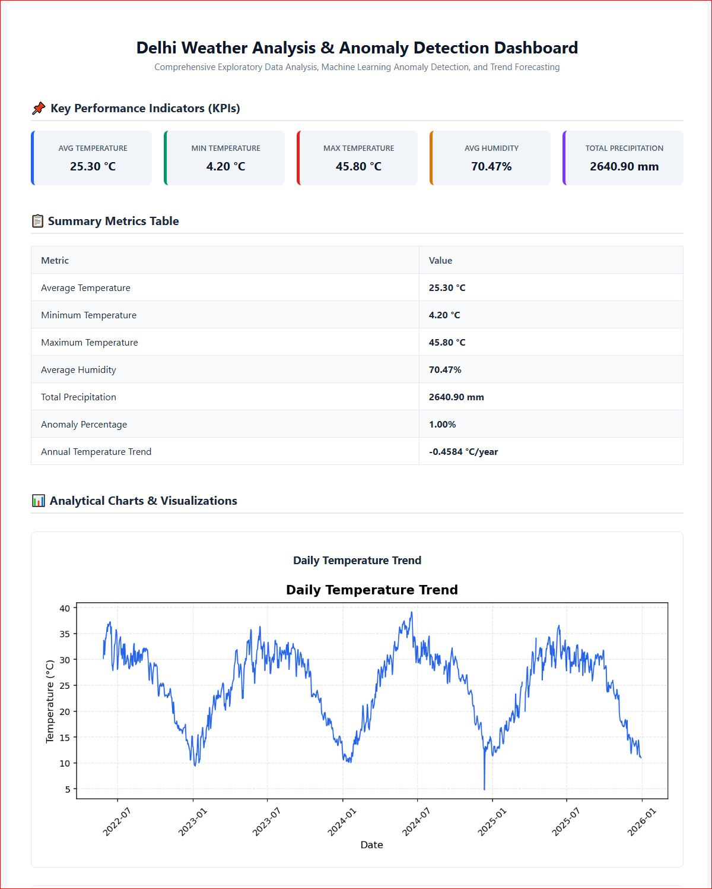
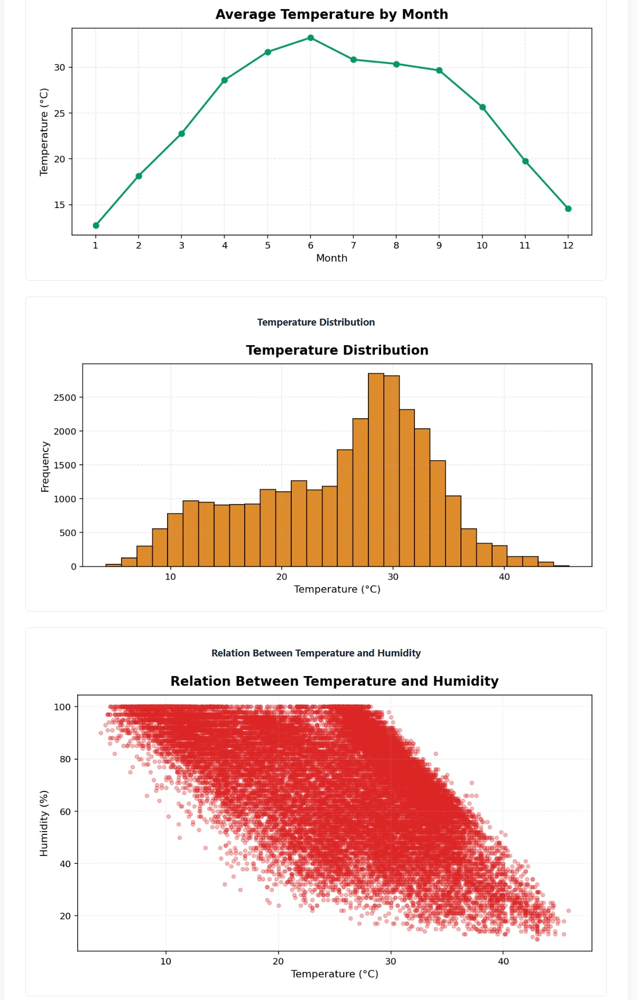
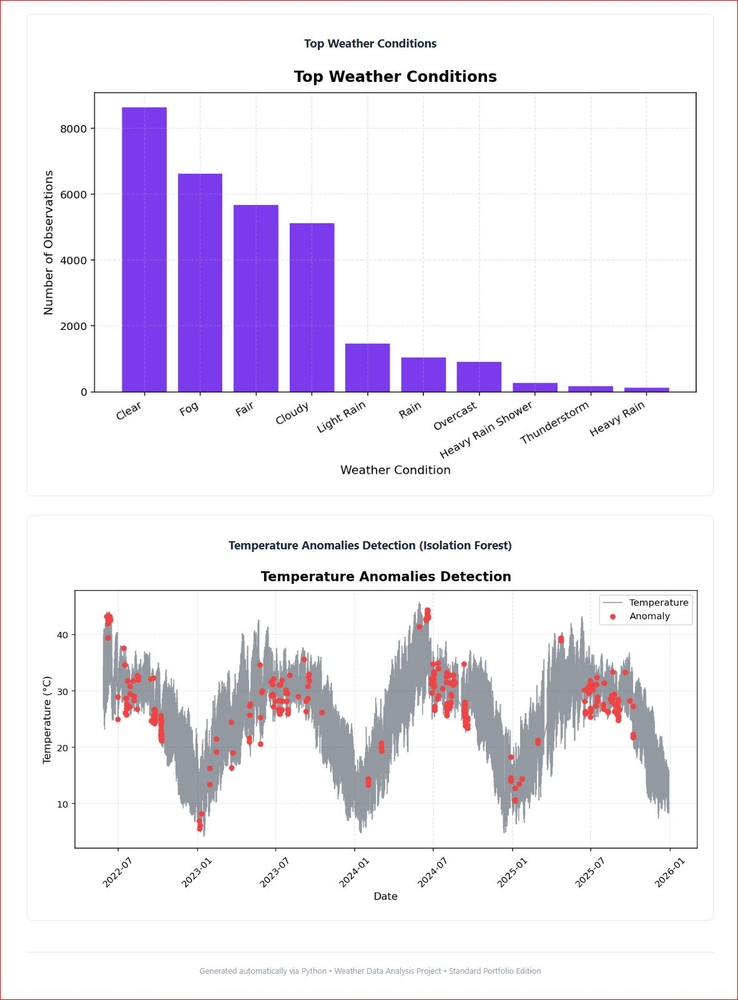

# Delhi Weather Analysis & ML Prediction Project

A complete Python-based data analysis and machine learning project exploring historical weather data from Delhi. This project processes weather metrics, generates statistical insights, detects anomalies, builds predictive models, and exports an interactive HTML report with dashboard previews.

## 🚀 Key Features
- **Data Cleaning & Preprocessing:** Handles missing values, strips whitespace, and standardizes formats using `pandas`.
- **Exploratory Data Analysis (EDA):** Visualizes temperature trends, humidity, and weather conditions using `matplotlib`.
- **Anomaly Detection:** Applies `IsolationForest` from scikit-learn to identify abnormal/extreme weather days.
- **Predictive Modeling:** Utilizes `LinearRegression` to model and predict weather patterns.
- **Interactive Reporting:** Automatically generates a standalone single-page HTML report (`Weather_Report.html`).

---

## 📊 Dashboard Previews

   
   
  

---

## 🛠️ Tech Stack
- **Language:** Python
- **Libraries:** `pandas`, `matplotlib`, `scikit-learn`
- **Output:** HTML, JPEG

## 📁 Project Structure
- `FinalProjectWeather_en.py` - Main Python script containing all analysis and ML logic.
- `Weather_Report.html` - Generated standalone HTML report.
- `dashboard_preview*.JPG` - Visual snapshots of the generated reports/charts.
